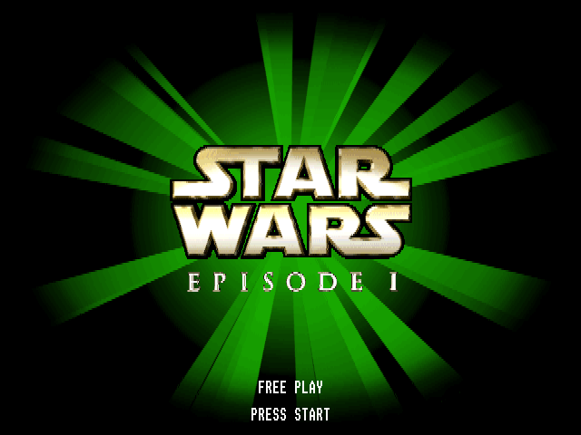
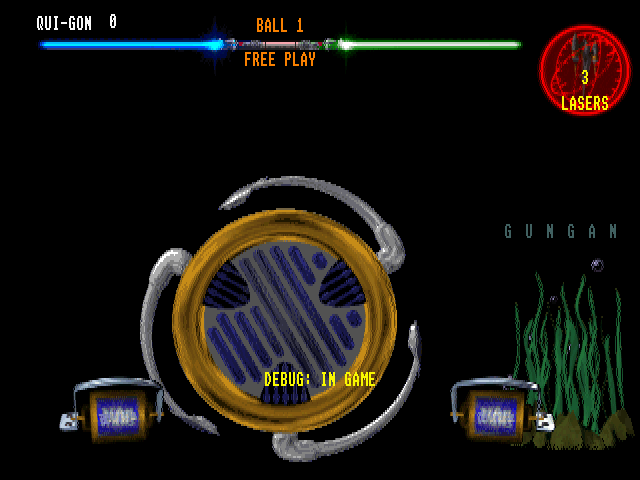
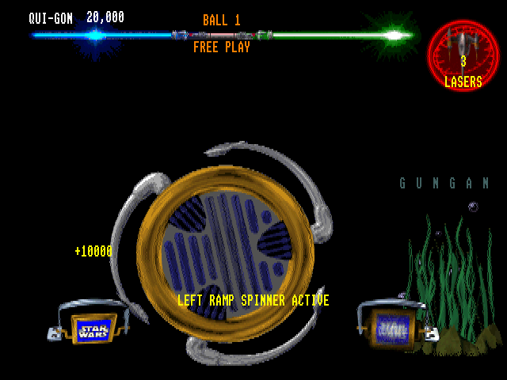
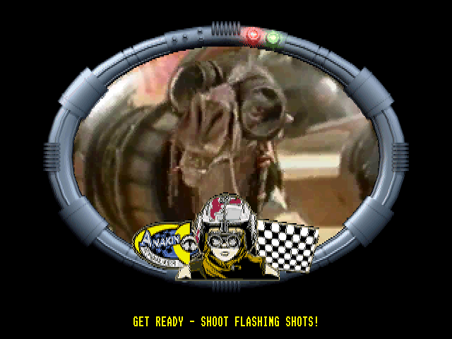
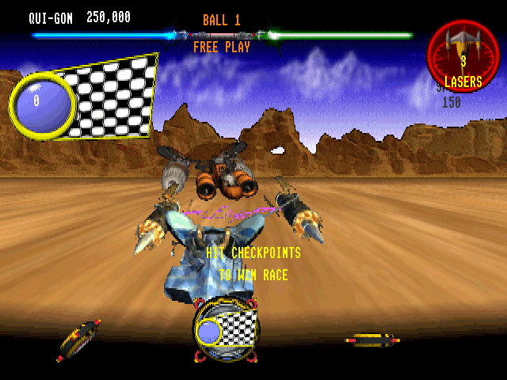
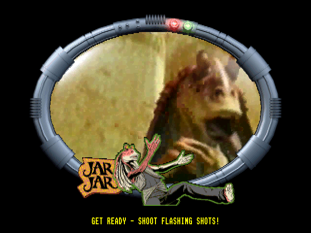
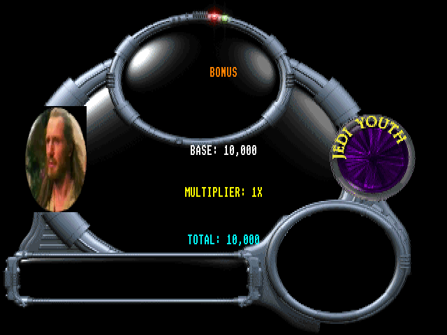
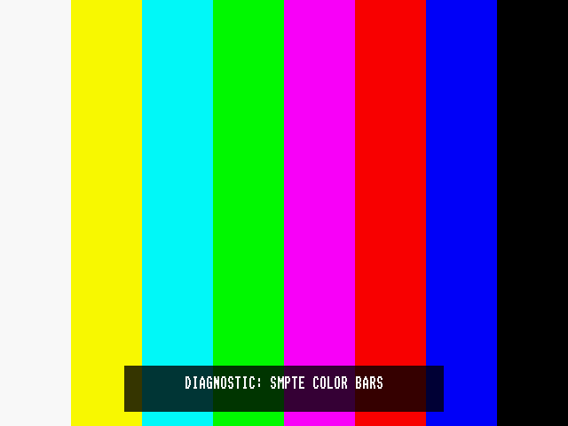

# Pinball 2000 → Native Rust Port (`pin2k`)

Clean-room native 64-bit Rust rewrite of the **Williams Pinball 2000** platform (*Star Wars Episode I* [`#50069`, 1999] and *Revenge From Mars* [`#50070`, 1999]), designed to run on **Linux and Windows** with zero external C library dependencies.

> **Legal / Clean-Room Boundary:** This repository contains no proprietary ROMs, images, fonts, animations, or audio tracks. All assets and gamecode scripts are extracted locally by the user from their own legitimate dumps (`swe1`, `rfm`, official/community `.exe`/`.zip` update packages, and `{game}_sound.bin`).
>
> **AI Transparency Notice (EU AI Act):** In accordance with the transparency obligations of the European Union Artificial Intelligence Act (Regulation (EU) 2024/1689), please note that the majority of the code, reverse-engineering ports, scripts, and documentation in this repository were generated and/or assisted using generative AI tools under human supervision and verification.

---

## Key Features

- **ROM Reconstruction, Verification & Full Asset Extraction (`pin2k-rom-tool`)**:
  - 16-bit word interleaving of the 8 PRISM Mask ROMs (`U100..U107` → 64 MiB) and DCS-2 audio ROMs (`U109/U110` → 8 MiB).
  - Native support for **official and community update bundles** (extracted directories, self-extracting `.exe` installers, `.zip` archives): `list-updates`, `assemble-update`, `verify`, `wrap-elf` (symbolized x86 ELF32).
  - **Complete asset extraction (`extract-assets`)**:
    - **Animations & video clips**: decodes **all** frames by default (codecs `0, 1, 20, 21, 22, 23, 30, 42, 43, 44, 45` with RGB555 `0x7C1F` transparency) → `gfx/*.png` + `gfx/gfx_manifest.json`.
    - **Bitmap fonts (`FontData` / `Character`)**: extracts all `font_*_data_ptr` bitmap fonts into RGBA8888 PNG atlases + per-glyph metrics → `fonts/*.png` + `fonts/fonts_manifest.json`.
    - **DCS-2 audio (`pb2kslib`)**: XOR `0x3A` decryption and Vorbis track extraction → `audio/*.ogg` + `audio/sound_manifest.json`.
  - **HD Sprite Upscaler (`upscale-assets`)**: pure-Rust edge-padded `Lanczos3` / `CatmullRom` / `Nearest` upscaling (`2×`–`4×`) into `gfx_hd/gfx_manifest.json` without dark/magenta fringes.
- **Gamecode & UI Layout Extraction (`pin2k-rom-tool` + Ghidra 12.2)**:
  - `extract-gamecode`: reads `SwitchTable` (96 switches), `DriveTable` (48 coils/flashers/neon), and `LampTable` (128 lamps) from `.data`, disassembles x86-32 handlers (`lift_x86_calls`), and generates **`game_script.json`**.
  - `extract-layout`: parses the symbolized x86 ELF32 in pure Rust (zero `unsafe`) and exports **`rom_layout_db.json`** (`14,841` symbols, `138` `Deff*` classes, `9` player characters, `14` scenes, `20` Attract screens, `702` `ACD`, `383` `ARD`: coordinates, Z-orders, fonts, and RGB555 colors).
  - **Ghidra 12.2** headless decompilation (`work/swe1_0200.elf`, `1,867` functions across `248` classes) ported natively to pure Rust in `swe1_audio.rs` (`382` `ARD` pools / `695` `ACD`, **100% of `689` DCS-2 tracks indexed**), `machine/leff.rs` (`14` lamp choreographies), `machine/fx/` (explosions, victories & overlays — **90.3% `gfx/` coverage**), and `machine/swe1_playfield.rs`.
- **Hardware-Faithful Game Engine & Desktop Runtime (`pin2k-core` + `pin2k-desktop`)**:
  - Z-sorted **`640×240` → `640×480`** software compositor (`BaseViewManager`), supporting `flip_x`, scaling, RGB555 monochrome tint, HD sprites (`--hd`), and drop shadows across all **19 ROM bitmap fonts**.
  - Native 60 Hz desktop window & fullscreen (`--window` / `--fullscreen`, `winit` + `softbuffer`, `4:3` letterboxing, `F11` / `Alt+Enter`) alongside a **5-tab Web Debug Console** (`--web-port`).
  - Authentic pure-Rust *Star Wars Episode I* (`#50069`) screens: player bar & lightsabers (`DeffScoreDisplay`), Naboo laser HUD (`DeffLaserStatusBackground`), ramp-only virtual spinners with turnstile sound (`DeffVSpinner`), **20 Attract Mode screens** (Star Wars logo + 9-color light rays `DeffAttractModeKahunaLogo`), **all 14 scenes** (isolated 2× bezel intros + active gameplay + unified 3D *Boonta Eve Podrace*), Multiballs, `DeffBonus`, `DeffMatch`, `DeffGameOver`, `DeffHSTDinitials`, `DeffTilt`, and full **Diagnostics / Admin** screens (`align`, `colorbar`, `grid`, `rgb`, `fuse`, `switch`, `coil`, `lamp`).
  - *Revenge From Mars* (`#50070`) rules, complete `ScriptRuntime` (per-player `player_vars` 1–4P, timers, modes), Mods/Homebrew (`mod.json`), JSONL event bus (`--events-log`, `/api/events`), and pure-Rust OGG/PCM audio (`lewton` → `winmm.dll` / `aplay` + WebAudio).
- **Power Driver Board Hardware Abstraction (`pin2k-hal`)**:
  - Wire-exact PDB protocol over Linux parallel port (`/dev/parportN` `ppdev`, `/dev/port` `0x378`), cross-platform Windows/Linux Serial UART bridge (`COMx`, `/dev/ttyUSB0`), and `VirtualPdbPort` + `--lpt-trace`.

---

## Screenshots (`640×480` Native Compositor Output)

| Attract Mode (`attract:0`) | Nominal Gameplay HUD (`ingame`) |
|---|---|
|  |  |
| **Virtual Spinner (`spinner_left`)** | **Scene Intro Bezel (`scene:6` Intro)** |
|  |  |
| **Boonta Eve Podrace (`scene:6`)** | **Jar Jar Juggle (`scene:9`)** |
|  |  |
| **End-of-Ball Bonus (`bonus`)** | **Diagnostic Color Bar (`diag:colorbar`)** |
|  |  |

---

## Workspace Architecture

| Crate | Role | Documentation |
|---|---|---|
| `crates/pin2k-rom-tool` | PRISM/DCS reconstruction, `.exe`/`.zip` updates, ELF32, `.png`/fonts/`.ogg` extraction, `extract-gamecode`, `extract-layout`, `upscale-assets` | [ARCHITECTURE_GUIDE.md](docs/ARCHITECTURE_GUIDE.md) |
| `crates/pin2k-hal` | Hardware/video/audio traits, `PdbDriver`, `LinuxPpdevPort`, `SerialPdbPort` (Win/Linux), `VirtualPdbPort` | [HARDWARE_NOTES.md](docs/HARDWARE_NOTES.md) |
| `crates/pin2k-core` | 60 Hz machine, `ScriptRuntime`, SWE1 & RFM rules/tables, `Leff` & `FX` engines, Mods, `GameEvent`, Admin | [GAME_SCRIPT_REFERENCE.md](docs/GAME_SCRIPT_REFERENCE.md) |
| `crates/pin2k-desktop` | Native Windows/Linux runtime, `640×480` compositor, native window (`--window`/`--fullscreen`), native audio, Web Debug Console | [ARCHITECTURE_GUIDE.md](docs/ARCHITECTURE_GUIDE.md) |

---

## Quick Start (Step by Step)

### 1. Build the Project (Linux & Windows)

```bash
# Native release build (Linux or Windows)
cargo build --release --workspace

# Run all unit tests
cargo test --workspace

# Cross-compile for Windows from Linux
cargo build --release --workspace --target x86_64-pc-windows-gnu
# (or MSVC check: cargo check --workspace --target x86_64-pc-windows-msvc)
```

### 2. Reconstruct ROMs, Extract All Assets & Gamecode

```bash
# A. Reconstruct the flat PRISM ROM (64 MiB) and DCS ROM (8 MiB)
./target/release/pin2k-rom-tool reconstruct \
  --input-dir /path/to/roms --prefix swe1_ \
  --output ./work/swe1_prism_flat.bin \
  --dcs-output ./work/swe1_dcs_flat.bin

# B. Extract ALL animations (.png), bitmap fonts (fonts/*.png), and audio tracks (.ogg)
./target/release/pin2k-rom-tool extract-assets \
  --prism-flat ./work/swe1_prism_flat.bin \
  --update /path/to/updates/pin2000_50069_0200_02262016_B_10000000 \
  --sound-bin /path/to/roms/swe1_sound.bin \
  --output-dir ./work/swe1_assets

# C. Extract gamecode (hardware tables, x86 handlers, attract, modes, rules) to JSON
./target/release/pin2k-rom-tool extract-gamecode \
  --update /path/to/updates/pin2000_50069_0200_02262016_B_10000000 \
  --prism-flat ./work/swe1_prism_flat.bin \
  --output-dir ./work/swe1_assets/scripts

# D. Extract all UI layouts, coordinates, fonts, and Z-orders from ELF32
./target/release/pin2k-rom-tool extract-layout \
  --elf ./work/swe1_0200.elf \
  --output-dir ./work/swe1_assets/scripts

# E. (Optional) Generate edge-padded 2x HD sprites in gfx_hd/
./target/release/pin2k-rom-tool upscale-assets \
  --assets-dir ./work/swe1_assets --scale 2
```

### 3. Run the Game (`pin2k-desktop`)

```bash
# Native 60 Hz desktop window (or --fullscreen, optionally with --hd)
./target/release/pin2k-desktop \
  --assets-dir ./work/swe1_assets \
  --window --frames 0

# Interactive Web Cabinet + 5-tab Debug Console (browser http://127.0.0.1:8080)
./target/release/pin2k-desktop \
  --assets-dir ./work/swe1_assets \
  --web-port 8080 --frames 0

# Real Linux cabinet via parallel port (/dev/parport0)
./target/release/pin2k-desktop \
  --lpt-device /dev/parport0 \
  --assets-dir ./work/swe1_assets \
  --fullscreen --frames 0

# Serial UART bridge mode (Windows COM3 or Linux /dev/ttyUSB0)
./target/release/pin2k-desktop \
  --serial-device COM3 --serial-baud 115200 \
  --assets-dir ./work/swe1_assets \
  --events-log ./work/events.jsonl \
  --web-port 8080 --frames 0
```

### 4. Demo Scenarios, Debug Modes & Automated Captures

```bash
./target/release/pin2k-desktop --assets-dir ./work/swe1_assets --script demo --frames 280 --screenshot-out ./work/demo.png
./target/release/pin2k-desktop --assets-dir ./work/swe1_assets --script podrace --frames 285 --frames-out-dir ./work/podrace_frames
./target/release/pin2k-desktop --assets-dir ./work/swe1_assets --script admin --frames 48 --screenshot-out ./work/admin.png

# Direct launch of screens / scenes / diagnostics via `--debug-mode`
./target/release/pin2k-desktop --assets-dir ./work/swe1_assets --debug-mode attract:0 --frames 90 --screenshot-out ./work/kahuna.png
./target/release/pin2k-desktop --assets-dir ./work/swe1_assets --debug-mode spinner_left --frames 25 --screenshot-out ./work/spinner.png
./target/release/pin2k-desktop --assets-dir ./work/swe1_assets --debug-mode scene:12 --frames 250 --screenshot-out ./work/r2d2.png
./target/release/pin2k-desktop --assets-dir ./work/swe1_assets --debug-mode bonus --frames 20 --screenshot-out ./work/bonus.png
./target/release/pin2k-desktop --assets-dir ./work/swe1_assets --debug-mode diag:colorbar --frames 10 --screenshot-out ./work/colorbar.png
```

---

## Complete Documentation

- **[Screen Layouts, Coordinates & Debug Console Reference (`docs/SCREEN_LAYOUT_REFERENCE.md`)](docs/SCREEN_LAYOUT_REFERENCE.md)**
- **[Architecture, Build & CLI Guide (`docs/ARCHITECTURE_GUIDE.md`)](docs/ARCHITECTURE_GUIDE.md)**
- **[`game_script.json` Format & Gamecode Extraction Reference (`docs/GAME_SCRIPT_REFERENCE.md`)](docs/GAME_SCRIPT_REFERENCE.md)**
- **[Complete Asset Cross-Reference & Code Coverage Matrix (`docs/ASSETS_MATRIX.md`)](docs/ASSETS_MATRIX.md)**
- **[SWE1 ROM Extraction Inventory (`docs/SWE1_EXTRACTION_INVENTORY.md`)](docs/SWE1_EXTRACTION_INVENTORY.md)** & **[SWE1 Game Rules (`docs/SWE1_GAME_RULES.md`)](docs/SWE1_GAME_RULES.md)**
- **[RFM ROM Extraction Inventory (`docs/RFM_EXTRACTION_INVENTORY.md`)](docs/RFM_EXTRACTION_INVENTORY.md)** & **[RFM Game Rules (`docs/RFM_GAME_RULES.md`)](docs/RFM_GAME_RULES.md)**
- **[Technical Study: HD Upscaling & Rendering (`docs/HD_UPSCALING_GUIDE.md`)](docs/HD_UPSCALING_GUIDE.md)**
- **[Roadmap, Playability Score & TODO (`docs/TODO.md`)](docs/TODO.md)**
- **[Hardware Reference, ROM Formats & PDB Protocol (`docs/HARDWARE_NOTES.md`)](docs/HARDWARE_NOTES.md)**

---

## License & Legal Notice

- **Source code license**: dual-licensed under **[MIT](LICENSE-MIT) OR [Apache-2.0](LICENSE-APACHE)**.
- **Non-affiliation**: this independent community project is not affiliated with, endorsed by, or sponsored by **Williams Electronics**, **Planetary Pinball**, **Lucasfilm Ltd.**, or **The Walt Disney Company**. *Pinball 2000*, *Star Wars*, and *Revenge From Mars* are registered trademarks of their respective owners, cited solely for interoperability and hardware preservation.
