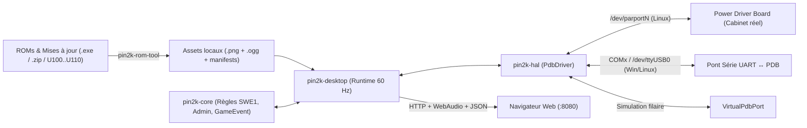

# Guide Complet d'Architecture, Fonctionnement et Utilisation (`pin2k`)

Ce document détaille la conception technique, les principes de fonctionnement, les protocoles matériels et le mode d'emploi complet du portage Rust de **Williams Pinball 2000 — *Star Wars Episode I* (`#50069`)**.

---

## 1. Principe Général & Objectif du Projet

En 1999, la plateforme **Pinball 2000** reposait sur un PC embarqué Cyrix MediaGX (x86 32-bit sous XINA RTOS), une carte PCI propriétaire **PRISM** (8 Mask ROMs + 4 Mio de Flash + DSP audio ADSP-2105 DCS-2) et une carte de puissance **Power Driver Board (PDB)** pilotée via le port parallèle IEEE-1284.

Le projet `pin2k` remplace intégralement cette pile matérielle et logicielle obsolète par une application **Rust native 64-bit** :
1. **Clean-Room & Séparation Actifs/Code** : le code source Rust est 100 % original et open-source. Aucun fichier propriétaire n'est stocké dans le dépôt ; l'utilisateur extrait ses propres assets (`.png`, `.ogg`) depuis ses ROMs locales.
2. **Multiplateforme sans dépendance C externe** : compile et s'exécute nativement sous **Linux** et **Windows** (`x86_64-pc-windows-msvc` / `x86_64-pc-windows-gnu`) avec zéro bibliothèque système C requise (`winmm.dll` et `CreateFileW` natifs sous Windows ; `libc`/`termios`/`ppdev` natifs sous Linux).
3. **Fidélité Matérielle & Événementielle** : les tables de switchs, bobines, lampes, optos et commandes audio proviennent directement de l'analyse statique de `swe1_0200.elf` (14 841 symboles C++).

---

## 2. Organisation des Crates

### `crates/pin2k-rom-tool` — Outil Offline ROM & Extraction
- **`interleave.rs`** : réassemble les paires de puces 16-bit (`U100/U101` .. `U106/U107`) en une image plate 32-bit little-endian de **64 Mio** (`prism_flat.bin`), et `U109/U110` en **8 Mio** (`dcs_flat.bin`). Supporte les répertoires et les archives MAME `.zip`.
- **`prism.rs`** :
  - Parse l'Option ROM PCI (`146E:0001`, vecteur protégé `0008:000801D9`) et les en-têtes `BootData`.
  - Vérifie les **12 sommes de contrôle matérielles** (`Bank0 Base`, `BAR3 Update`, `Masked Image Bank 0..3`).
  - **`load_update_bundle`** : charge n'importe quelle mise à jour Pinball 2000 depuis un **dossier**, un **installeur `.exe` auto-extractible** ou une **archive `.zip`**.
- **`symbols.rs` & `elf_writer.rs`** : parse `*_symbols.rom` (`SYMBOL TABLE`) et génère un binaire ELF32 x86 standard (`0x00100000`) directement exploitable dans Ghidra, `objdump` ou `readelf`.
- **`gfx_decoder.rs` & `asset_extractor.rs`** :
  - Décode tous les formats graphiques Pinball 2000 (`0, 1, 20, 21, 22, 23, 30, 42, 43, 44, 45`) avec transparence `0x7C1F` vers `.png` RGBA8888 + `gfx_manifest.json`.
  - Extrait les pistes Vorbis du conteneur `pb2kslib` (`{jeu}_sound.bin`, XOR `0x3A`) vers `.ogg` + `sound_manifest.json`.

### `crates/pin2k-hal` — Abstraction Matérielle & Communication PDB
- **Traits découplés (`lib.rs`)** : `PinballHardware`, `VideoBackend`, `AudioBackend`.
- **Protocole Parallèle exact (`pdb_driver.rs`, `lpt.rs`)** :
  - Implémente les 6 étapes exactes de `PinIOWrite` (`0x001a8360`) et `PinIORead` (`0x001a8450`) : capture de l'opcode registre sur front montant du bit 2 de `CONTROL` (`0x00 → 0x04`), puis validation sur front descendant du bit 0 (`0x05 → 0x04`) ou lecture inversée (`0x2D`).
  - Détection de présence `(STATUS & 0xF8) != 0x78` (`0x87` présent, `0x7F` bus ouvert).
  - Lecture des fusibles (`0x12`, `0x13`), identification automatique du plateau (`0x10`/`0x11` : `Swe1` vs `Rfm`), gestion des optos actifs-bas (`SWE1_OPTO_NC_MASK` pour `Sw 24..30, 32, 39`), verrouillage haute tension lorsque la porte monnayeur (`Sw 81`) est ouverte.
  - Pilotage des **48 sorties bobines/flashers/néon** (`0x0B, 0x0A, 0x09, 0x0D, 0x0C, 0x0E`) et multiplexage des **128 lampes** (`0x06` Matrice A, `0x07` Matrice B, `0x08` strobe colonne).
- **Port Série Multiplateforme (`serial.rs`)** :
  - `NativeSerialPort` sans dépendance externe : Win32 (`CreateFileW`, `SetCommState`, `SetCommTimeouts`, `ReadFile`, `WriteFile`) sous Windows (`COMx`) et `termios` (`libc`) sous Linux (`/dev/ttyUSB0`, `/dev/ttyACM0`, `/dev/ttyS0`).
  - `SerialPdbPort` encapsule les transactions `LptPort` en trames compactes (`'W' reg val`, `'R' reg`) pour dialoguer avec un pont microcontrôleur USB-Série ↔ PDB.

### `crates/pin2k-core` — Moteur de Jeu, Événements & Administration
- **Tables matérielles (`swe1_tables.rs`)** : constantes typées pour les 96 switchs (`0..63` matrice + `64..95` directs), 48 bobines/flashers avec coordonnées `(x, y)`, 128 lampes et commandes sonores DCS.
- **Anti-rebond (`switch_matrix.rs`)** : filtrage 2 ticks (`SwitchDebouncer`) sur les 12 colonnes logiques.
- **Règles de jeu (`swe1_rules.rs`, `machine.rs`)** :
  - Modes `Attract`, `InGame`, `Tilt`, `Diagnostics`.
  - Gestion 1 à 4 joueurs, Trough 4 billes, Force Ball Save, recherche de bille (15 s), Skill Shot, Batteurs + changement de lettres `J-E-D-I`, Boutons Laser, Cibles tombantes & Soucoupes → **Theed Hangar 3-Ball Multiball** (Jackpots + Super Jackpot), Bouclier Déflecteur motorisé (`Drive 36/37`) → **12 Scènes Holoprojecteur** (dont *Boonta Eve Podrace*), `J-E-D-I` complet → **Duel au Sabre contre Darth Maul** (`Lightsaber Neon` Drive 40 + promotion de rang Jedi), High Scores.
- **Bus d'événements (`events.rs`)** : `Pin2kMachine::drain_events()` produit des `TimestampedEvent` (`CreditAdded`, `SwitchChanged`, `CoilFired`, `SoundTriggered`, `SceneStarted`, `SceneCompleted`, `MultiballStarted`, `JackpotAwarded`, `JediRankPromoted`, `AdminMenuEntered`, `AdjustmentChanged`, etc.).
- **Menu d'Administration Opérateur (`admin.rs`)** :
  - Accessible depuis le mode `Attract` avec le bouton `Enter` (`Sw 75`) et navigable via `Up` (`Sw 74`), `Down` (`Sw 73`), `Enter` (`Sw 75`), `Escape` (`Sw 72`) :
    - **Diagnostics** : `Switch Test`, `Coil / Solenoid Test`, `Lamp Test`, `Sound / DCS Test`.
    - **Audits** : parties jouées, billes jouées, crédits, scènes démarrées/gagnées, multiballs, duels Maul gagnés, meilleur score.
    - **Adjustments** : `Free Play`, `Balls/Game` (3/5), `Ball Save` (10s/15s/20s), `Tilt Warnings` (2/3/4), `Master Volume` (25%–100%), `Difficulty` (Easy/Medium/Hard).
    - **Utilities** : `Reset High Scores`, `Clear Audits`, `Factory Defaults`.

### `crates/pin2k-desktop` — Application Native
- **`compositor.rs`** : rendu logiciel `640×480` avec décodage paresseux à la demande des animations `.png`, compositeur multi-couches dédié pour *Boonta Eve Podrace* (grille de départ + parallaxe ciel/canyon/sol + Podracer Anakin + explosions + compteur vitesse), affichage du menu d'administration, et panneau bas des 128 lampes / 48 bobines / état PDB.
- **`audio.rs`** : décodeur OGG Vorbis pur-Rust (`lewton`) vers PCM `i16`, lecture native via `winmm.dll` (`waveOutOpen`) sous Windows ou `aplay` sous Linux, couplée au bridge WebAudio.
- **`web_ui.rs`** : serveur HTTP pur-Rust sans dépendance servant la console HTML5 (`/`), le flux image (`/frame.png`), l'état JSON (`/api/state`), les événements (`/api/events`), les fichiers `.ogg` (`/audio/...`) et l'injection de switchs (`POST /api/switch/{id}`).

---

## 3. Référence Complète des Commandes

### `pin2k-rom-tool`

| Sous-commande | Usage |
|---|---|
| `reconstruct` | Interleave `U100..U107` (et `U109/U110` via `--dcs-output`) depuis `--input-dir` ou `--input-zip` |
| `list-updates` | Liste les paquets de mise à jour (`.exe`, `.zip`, dossiers) dans `--dir` avec version jeu et XINA |
| `assemble-update` | Assemble une image Flash `BAR3` (4 Mio) depuis `--bundle-dir` (dossier, `.exe` ou `.zip`) |
| `verify` | Vérifie l'Option ROM, `BootData` et les 12 checksums PRISM / `BAR3` |
| `wrap-elf` | Génère un `ELF32` x86 symbolisé (`game.rom` + `symbols.rom`) |
| `extract-assets` | Exporte les animations `.png` (`--update` ou `--game` + `--symbols`) et l'audio `.ogg` (`--sound-bin`) |
| `scan` / `preview` / `symbols` | Inspection ASCII/en-têtes, aperçu brut RGB555/RGB565/Indexed8 et résolution de symboles |

### `pin2k-desktop`

| Option CLI | Description | Défaut |
|---|---|---|
| `--lpt-device <SPEC>` | `auto`, `emulated`, `/dev/parportN` (Linux), `ioport:0x378` (Linux), `serial:<DEV>` | `auto` |
| `--serial-device <DEV>` | Port série direct (`COM3` sous Windows, `/dev/ttyUSB0` sous Linux) | — |
| `--serial-baud <BAUD>` | Vitesse UART (9600 à 921600) | `115200` |
| `--assets-dir <DIR>` | Dossier contenant `gfx/gfx_manifest.json` et `audio/sound_manifest.json` | — |
| `--rom-update <PATH>` | Charge et vérifie une mise à jour ROM (dossier, `.exe` ou `.zip`) | — |
| `--web-port <PORT>` | Démarre l'interface Web + WebAudio sur `http://127.0.0.1:<PORT>` | — |
| `--no-native-audio` | Désactive la lecture audio native OS (utile en environnement headless/CI) | `false` |
| `--lpt-trace <FILE>` | Enregistre chaque lecture/écriture octet sur le bus parallèle | — |
| `--events-log <FILE>` | Enregistre chaque `TimestampedEvent` (`GameEvent`) en JSON Lines | — |
| `--script <NAME>` | Scénario automatique : `none`, `demo`, `podrace`, `admin`, `diagnostics` | `none` |
| `--frames <N>` | Nombre de frames à exécuter (`0` = boucle infinie temps réel) | `60` |
| `--realtime` | Cadence à 60 Hz (`16 ms`/frame), activé automatiquement avec `--web-port` | `false` |
| `--screenshot-out <PNG>` | Sauvegarde la dernière image `640×480` en PNG | — |
| `--frames-out-dir <DIR>` | Exporte chaque frame `frame_0000.png`.. pour encodage vidéo | — |

---

## 4. Raccourcis Clavier de l'Interface Web (`--web-port`)

| Touche | Switch logique | Action |
|---|---|---|
| `C` | `64` (`Left Coin`) | Insérer un crédit |
| `S` | `2` (`Start Button`) | Démarrer une partie / Ajouter un joueur (1–4) |
| `Z` / `M` | `85` / `84` | Batteur Gauche / Batteur Droit (et rotation `J-E-D-I`) |
| `X` / `.` | `87` / `86` | Bouton Laser Gauche / Bouton Laser Droit |
| `L` / `R` | `36` / `37` | Rampe Gauche / Rampe Droite |
| `H` | `34` | Cible Bouclier Déflecteur |
| `P` | `32` | Scoop Central (`Shield Popper` → Scènes & Super Jackpot) |
| `K` | `22` | Soucoupe Gauche (Blocage Multiball Hangar) |
| `J` | `45` | Couloir Jets (`Skill Shot` / Multiplicateur Bonus) |
| `1` / `2` / `3` / `4` | `72` / `73` / `74` / `75` | Boutons porte monnayeur : `Escape` / `Down` / `Up` / `Enter` (**Menu Admin**) |
