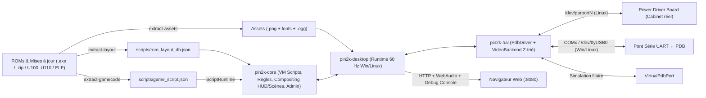

# Guide Complet d'Architecture, Fonctionnement et Utilisation (`pin2k`)

Ce document détaille la conception technique, l'extraction des assets et du gamecode, le moteur de scripts et la compilation native **Linux et Windows** du portage Rust de **Williams Pinball 2000** (*Star Wars Episode I* [`#50069`] et *Revenge From Mars* [`#50070`]).

---

## 1. Principe Général & Objectif du Projet

En 1999, la plateforme **Pinball 2000** reposait sur un PC embarqué Cyrix MediaGX (x86 32-bit sous XINA RTOS), une carte PCI propriétaire **PRISM** (8 Mask ROMs + 4 Mio de Flash + DSP audio ADSP-2105 DCS-2) et une carte de puissance **Power Driver Board (PDB)** pilotée via le port parallèle IEEE-1284.

Le projet `pin2k` remplace intégralement cette pile matérielle et logicielle par une architecture **Rust native 64-bit** en 3 étapes :
1. **Extraction complète des assets (`pin2k-rom-tool extract-assets`)** : toutes les animations (`.png`), toutes les polices bitmap (`fonts/*.png` + métriques), et toutes les pistes audio (`.ogg`).
2. **Extraction du gamecode & des layouts UI (`pin2k-rom-tool extract-gamecode` / `extract-layout`)** : extraction des tables matérielles (`SwitchTable`, `DriveTable`, `LampTable`), des appels x86 (`score`, `AudioRequest`, etc.) vers `game_script.json`, ainsi que des `138` classes `Deff*`, `14` scènes, `20` slides Attract, `9` personnages, positions et priorités Z vers `rom_layout_db.json`.
3. **Runtime natif multiplateforme (`pin2k-desktop` + `pin2k-core`)** : exécute les assets, layouts et `game_script.json` à 60 Hz sans aucune dépendance C externe, compilable nativement sous **Linux** et **Windows** (`x86_64-pc-windows-msvc` / `x86_64-pc-windows-gnu`).



---

## 2. Organisation des Crates

### `crates/pin2k-rom-tool` — Outil Offline ROM, Assets & Gamecode
- **`interleave.rs`** : réassemble les paires de puces 16-bit (`U100/U101` .. `U106/U107`) en une image plate 32-bit little-endian de **64 Mio** (`prism_flat.bin`), et `U109/U110` en **8 Mio** (`dcs_flat.bin`). Supporte répertoires et archives MAME `.zip`.
- **`prism.rs`** : parse l'Option ROM PCI (`146E:0001`), les en-têtes `BootData`, vérifie les **12 checksums matériels**, et charge les mises à jour depuis dossier, `.exe` ou `.zip` (`load_update_bundle`).
- **`symbols.rs` & `elf_writer.rs`** : parse `*_symbols.rom` (`SYMBOL TABLE`) et génère un binaire ELF32 x86 standard (`0x00100000`) pour Ghidra, `objdump` ou `readelf`.
- **`gfx_decoder.rs` & `asset_extractor.rs`** :
  - **`extract_named_animations`** : décode tous les formats graphiques Pinball 2000 (`0, 1, 20, 21, 22, 23, 30, 42, 43, 44, 45`) avec transparence `0x7C1F` vers `.png` RGBA8888 + `gfx_manifest.json`. Sans `--max-frames`, extrait **100 % des frames** de chaque animation.
  - **`extract_fonts`** : lit les structures `FontData` (24 octets) et `Character` (28 octets) pointées par les symboles `font_*_data_ptr`, génère un atlas PNG RGBA8888 par police et écrit `fonts/fonts_manifest.json`.
  - **`extract_pb2kslib_sounds`** : extrait les pistes Vorbis du conteneur `pb2kslib` (`{jeu}_sound.bin`, XOR `0x3A`) vers `.ogg` + `sound_manifest.json`.
- **`gamecode_extractor.rs`** :
  - Lit `DriveTable` (48 × 24 o), `LampTable` (128 × 36 o) et `SwitchTable` (96 × 48 o) depuis la mémoire virtuelle `game.rom` / `prism_flat.bin`.
  - `lift_x86_calls` décode les instructions x86-32 (`PUSH imm8/imm32`, `CALL rel32`, `ADD ESP`, `RET`) dans chaque handler `swd_*` pour extraire les appels `score`, `generic_score`, `AudioRequest`, `traverse_and_call`.
  - Écrit `game_script.json` (voir [GAME_SCRIPT_REFERENCE.md](GAME_SCRIPT_REFERENCE.md)).
- **`layout_extractor.rs`** :
  - Parseur ELF32 i386 pur-Rust (zéro `unsafe`) qui désassemble les méthodes des `138` classes `Deff*` (`Run`, `Startup`, `Shutdown`), résout les références symboliques vers les animations/polices/sons, et extrait les coordonnées `SetPos`, priorités Z `Display`, couleurs RGB555, délais `sleep`, ainsi que les `9` personnages joueurs, `14` scènes (`SceneDataInfo`), `20` écrans Attract (`AttractProcInfo`), `702` `ACD` et `383` `ARD` dans `rom_layout_db.json`.

### `crates/pin2k-hal` — Abstraction Matérielle & Communication PDB
- **Traits découplés (`lib.rs`)** : `PinballHardware`, `VideoBackend` (avec file Z-ordonnée `begin_frame`, `draw_named_sprite` / `SpriteDrawCmd`, `draw_font_text` / `TextDrawCmd`, `draw_rect` / `RectDrawCmd`, `TextAlign`), `AudioBackend`, et `HeadlessVideo` / `HeadlessAudio`.
- **Protocole Parallèle exact (`pdb_driver.rs`, `lpt.rs`)** : implémente `PinIOWrite` / `PinIORead`, détection de présence `(STATUS & 0xF8) != 0x78`, fusibles, signature plateau (`Swe1` vs `Rfm`), optos actifs-bas (`SWE1_OPTO_NC_MASK`), verrou porte monnayeur (`Sw 81`), 48 sorties bobines/flashers/néon et 128 lampes.
- **Port Série Multiplateforme (`serial.rs`)** : `NativeSerialPort` sans dépendance externe (`CreateFileW`/Win32 sous Windows `COMx`, `termios` sous Linux `/dev/ttyUSB0`) + protocole `SerialPdbPort`.

### `crates/pin2k-core` — Moteur de Jeu, Compositing Natif & Script VM
- **`machine/`** (architecture modulaire 60 Hz autour de `Pin2kMachine` dans `machine/mod.rs`, avec `hw.sync(0)` au démarrage avant amorçage de `switch_matrix.rs`) :
  - `score_display.rs` (`DeffScoreDisplay`), `hud_display.rs` (`DeffLaserStatusBackground`), `vspinner.rs` (`VirtualSpinners` uniquement sur passage rampe).
  - `attract_render.rs` (20 écrans `AttractDeff` + flare Kahuna 9 couleurs), `scene_render.rs` (14 scènes `Swe1Scene` intros + fonds, `DeffObiHolo`, Multiballs, Skill Shot), `system_screens.rs` (`PowerupTestingDeff`, 12 `SpecialScreen`, `DeffTilt`, `DeffHSTDinitials`, et `DiagPage` / menus Opérateur).
  - `render.rs`, `script_exec.rs` (`debug_launch_mode` / `debug_apply_player_cmd`), `swe1_playfield.rs`, `rfm_playfield.rs`, `admin_nav.rs`, `tests.rs`.
- **`script_engine.rs`** : `GameScript` & `ScriptRuntime` exécutant `game_script.json`.
- **Règles & tables** : `swe1_rules.rs`, `swe1_tables.rs`, `attract.rs`, `rfm_rules.rs`, `rfm_tables.rs`, `mods.rs`, `events.rs`, `admin.rs`, `storage.rs`.

### `crates/pin2k-desktop` — Application Native Windows & Linux
- **`compositor.rs`, `raster.rs`, `scenes_compositor.rs`** : compositeur logiciel `BaseViewManager` `640×240` → `640×480` trié par Z (avec `flip_x`, échelle, teinte RGB555, ombres bitmap sur les 19 polices ROM, export JSON des calques live et compositeur multi-couches *Boonta Eve Podrace*).
- **`runner.rs` & `cli.rs`** : boucle 60 Hz, scénarios auto (`--script`), lancements directs (`--debug-mode`), capture PNG (`--screenshot-out`, `--frames-out-dir`), télémétrie.
- **`audio.rs`** : décodeur OGG Vorbis pur-Rust (`lewton`), lecture native via `winmm.dll` (`waveOutOpen`) sous Windows ou `aplay` sous Linux + WebAudio.
- **`web_ui.rs` & `web_ui.html`** : serveur HTTP pur-Rust servant la Console Debug Web à 5 onglets (`/`), `/frame.png`, `/api/state`, `/api/assets`, `/api/events`, `/api/db`, `/audio/...`, `POST /api/switch/{id}` et `POST /api/debug/*` (avec décodage URL `percent_decode`).

---

## 3. Référence Complète des Commandes

### `pin2k-rom-tool`

| Sous-commande | Usage |
|---|---|
| `reconstruct` | Interleave `U100..U107` (et `U109/U110` via `--dcs-output`) depuis `--input-dir` ou `--input-zip` |
| `list-updates` | Liste les paquets de mise à jour (`.exe`, `.zip`, dossiers) dans `--dir` avec version jeu et XINA |
| `assemble-update` | Assemble une image Flash `BAR3` (4 Mio) depuis `--bundle-dir` (dossier, `.exe` ou `.zip`) |
| `verify` | Vérifie l'Option ROM, `BootData` et les 12 checksums PRISM / `BAR3` |
| `wrap-elf` | Génère un `ELF32` x86 symbolisé (`game.rom` + `symbols.rom`) |
| `extract-assets` | Exporte **toutes** les animations (`gfx/*.png`), les polices (`fonts/*.png`) et l'audio (`audio/*.ogg`) |
| `extract-gamecode` | Extrait les tables matérielles, handlers x86, attract, modes et règles vers `game_script.json` |
| `extract-layout` | Analyse l'ELF32 x86 et extrait `rom_layout_db.json` (138 `Deff*`, positions, Z, polices, couleurs, `ACD`/`ARD`) |
| `scan` / `preview` / `symbols` | Inspection ASCII/en-têtes, aperçu brut RGB555/RGB565/Indexed8 et résolution de symboles |

### `pin2k-desktop`

| Option CLI | Description | Défaut |
|---|---|---|
| `--lpt-device <SPEC>` | `auto`, `emulated`, `/dev/parportN` (Linux), `ioport:0x378` (Linux), `serial:<DEV>` | `auto` |
| `--serial-device <DEV>` | Port série direct (`COM3` sous Windows, `/dev/ttyUSB0` sous Linux) | — |
| `--serial-baud <BAUD>` | Vitesse UART (9600 à 921600) | `115200` |
| `--assets-dir <DIR>` | Dossier contenant `gfx/`, `fonts/`, `audio/` et optionnellement `scripts/game_script.json` | — |
| `--game-script <PATH>` | Chemin explicite vers `game_script.json` (prioritaire sur l'auto-détection) | — |
| `--db-path <PATH>` | Chemin vers la base JSON locale (`pin2k_db.json` : HSTD, Audits, Adjustments) | `<assets-dir>/pin2k_db.json` |
| `--debug-mode <MODE>` | Lance directement un écran/mode (`attract:0..19`, `ingame`, `scene:0..13`, `spinner_left`, `bonus`, `diag:colorbar`, …) | — |
| `--strict-script` | Active l'exécution stricte par `game_script.json` sans fallback Rust | `false` |
| `--telemetry-overlay` | Affiche la télémétrie lampes/bobines sous l'écran au lieu du plein écran 640×480 | `false` |
| `--game <TITLE>` | `auto`, `swe1`, `rfm`, ou `homebrew` | `auto` |
| `--mod <DIR>` | Charge un ou plusieurs dossiers Mod / Homebrew (`mod.json`) | — |
| `--rom-update <PATH>` | Charge et vérifie une mise à jour ROM (dossier, `.exe` ou `.zip`) | — |
| `--web-port <PORT>` | Démarre l'interface Web + Debug Console + WebAudio sur `http://<web-bind>:<PORT>` | — |
| `--web-bind <ADDR>` | Adresse d'écoute HTTP | `0.0.0.0` |
| `--no-native-audio` | Désactive la lecture audio native OS (utile en CI/headless) | `false` |
| `--lpt-trace <FILE>` | Enregistre chaque lecture/écriture octet sur le bus parallèle | — |
| `--events-log <FILE>` | Enregistre chaque `TimestampedEvent` (`GameEvent`) en JSON Lines | — |
| `--script <NAME>` | Scénario automatique : `none`, `demo`, `rfm-demo`, `podrace`, `admin`, `diagnostics`, `all-sequences` | `none` |
| `--frames <N>` | Nombre de frames à exécuter (`0` = boucle infinie temps réel) | `60` |
| `--realtime` | Cadence à 60 Hz (`16 ms`/frame), activé automatiquement avec `--web-port` | `false` |
| `--screenshot-out <PNG>` | Sauvegarde la dernière image `640×480` en PNG | — |
| `--frames-out-dir <DIR>` | Exporte chaque frame `frame_0000.png`.. pour encodage vidéo | — |

---

## 4. Compilation Multiplateforme (Linux & Windows)

Le workspace ne dépend d'aucune bibliothèque C externe (`openssl`, `sdl2`, etc.) :
- **Linux (`x86_64-unknown-linux-gnu`)** :
  ```bash
  cargo build --release --workspace
  ```
- **Windows depuis Windows (`x86_64-pc-windows-msvc`)** :
  ```powershell
  cargo build --release --workspace
  ```
- **Windows depuis Linux (`x86_64-pc-windows-gnu` avec MinGW-w64)** :
  ```bash
  cargo build --release --workspace --target x86_64-pc-windows-gnu
  # Binaire produit : target/x86_64-pc-windows-gnu/release/pin2k-desktop.exe
  ```

---

## 5. Raccourcis Clavier de l'Interface Web (`--web-port`)

| Touche | Switch logique | Action |
|---|---|---|
| `C` | `64` (`Left Coin`) | Insérer un crédit |
| `S` | `2` (`Start Button`) | Démarrer une partie / Ajouter un joueur (1–4) |
| `Z` / `M` | `85` / `84` | Batteur Gauche / Batteur Droit (et rotation `J-E-D-I`) |
| `X` / `.` | `87` / `86` | Bouton Laser Gauche / Bouton Laser Droit |
| `L` / `R` | `36` / `37` | Rampe Gauche / Rampe Droite |
| `H` | `34` | Cible Bouclier Déflecteur |
| `P` | `32` | Scoop Central (`Shield Popper` → Scènes & Super Jackpot) |
| `K` | `22` | Soucoupe Gauche (Blocage Multiball Hangar) |
| `J` | `45` | Couloir Jets (`Skill Shot` / Multiplicateur Bonus) |
| `1` / `2` / `3` / `4` | `72` / `73` / `74` / `75` | Boutons porte monnayeur : `Escape` / `Down` / `Up` / `Enter` (**Menu Admin**) |
