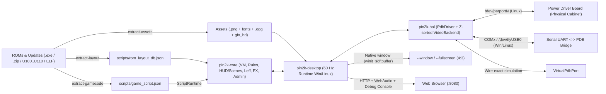

# Architecture, Build & CLI Guide (`pin2k`)

Technical overview of the crate architecture, ROM/asset/gamecode extraction pipeline, script runtime, and native **Linux & Windows** builds for the **Williams Pinball 2000** Rust port (*Star Wars Episode I* [`#50069`] and *Revenge From Mars* [`#50070`]).

---

## 1. Design Philosophy & Pipeline

The original 1999 **Pinball 2000** platform ran on an embedded Cyrix MediaGX PC (32-bit x86 running XINA RTOS), a proprietary PCI **PRISM** card (8 Mask ROMs + 4 MiB Flash + ADSP-2105 DCS-2 audio DSP), and a **Power Driver Board (PDB)** controlled over IEEE-1284 parallel port.

`pin2k` replaces this stack with a clean-room **64-bit native Rust** architecture in 3 stages:
1. **Asset extraction (`pin2k-rom-tool extract-assets` / `upscale-assets`)**: decodes all animations (`.png`), bitmap fonts (`fonts/*.png` + metrics), DCS-2 audio (`.ogg`), and optional edge-padded HD packs (`gfx_hd/`).
2. **Gamecode & UI layout extraction (`pin2k-rom-tool extract-gamecode` / `extract-layout`)**: lifts hardware tables (`SwitchTable`, `DriveTable`, `LampTable`), x86 calls (`score`, `AudioRequest`, etc.) into `game_script.json`, and all `138` `Deff*` classes, `14` scenes, `20` Attract slides, `9` characters, coordinates, and Z-orders into `rom_layout_db.json`.
3. **Cross-platform native runtime (`pin2k-desktop` + `pin2k-core`)**: executes at 60 Hz with zero external C dependencies on **Linux** and **Windows** (`x86_64-pc-windows-msvc` / `x86_64-pc-windows-gnu`).



---

## 2. Workspace Crates

### `crates/pin2k-rom-tool` — Offline ROM, Asset & Gamecode Tool
- **`interleave.rs`**: reassembles 16-bit chip pairs (`U100/U101`..`U106/U107`) into a flat 32-bit little-endian **64 MiB** image (`prism_flat.bin`), and `U109/U110` into **8 MiB** (`dcs_flat.bin`). Supports folders and MAME `.zip` archives.
- **`prism.rs`**: parses PCI Option ROM (`146E:0001`), `BootData` headers, verifies all **12 hardware checksums**, and loads updates from directories, `.exe`, or `.zip` (`load_update_bundle`).
- **`symbols.rs` & `elf_writer.rs`**: parses `*_symbols.rom` (`SYMBOL TABLE`) and emits a standard x86 ELF32 binary (`0x00100000`) for Ghidra, `objdump`, or `readelf`.
- **`gfx_decoder.rs` & `asset_extractor.rs`**: decodes all Pinball 2000 graphic codecs (`0, 1, 20..23, 30, 42..45`, transparency `0x7C1F`), extracts all **19 bitmap fonts** (`FontData`/`Character`), and decrypts `pb2kslib` (`{game}_sound.bin`, XOR `0x3A`) Vorbis audio.
- **`upscaler.rs`**: pure-Rust HD sprite upscaler (`upscale-assets`) with transparent RGB edge-padding (`Lanczos3`/`CatmullRom`/`Nearest`, `2×`–`4×`) outputting `gfx_hd/gfx_manifest.json`.
- **`gamecode_extractor.rs`**: reads `DriveTable` (48×24 B), `LampTable` (128×36 B), and `SwitchTable` (96×48 B), lifts x86 calls (`lift_x86_calls`), and writes `game_script.json` ([GAME_SCRIPT_REFERENCE.md](GAME_SCRIPT_REFERENCE.md)).
- **`layout_extractor.rs`**: pure-Rust ELF32 i386 parser (zero `unsafe`) disassembling all `138` `Deff*` classes and exporting `rom_layout_db.json`.

### `crates/pin2k-hal` — Hardware Abstraction & PDB Communication
- **Decoupled traits (`lib.rs`)**: `PinballHardware`, Z-sorted `VideoBackend` (`SpriteDrawCmd`, `TextDrawCmd`, `RectDrawCmd`, `TextAlign`), `AudioBackend`, and `HeadlessVideo` / `HeadlessAudio`.
- **Exact Parallel-Port Protocol (`pdb_driver.rs`, `lpt.rs`)**: `PinIOWrite` / `PinIORead`, presence check `(STATUS & 0xF8) != 0x78`, fuses, playfield signature (`Swe1`/`Rfm`), active-low optos (`SWE1_OPTO_NC_MASK`), coin door interlock (`Sw 81`), 48 drives, and 128 lamps.
- **Cross-platform Serial Bridge (`serial.rs`)**: zero-C `NativeSerialPort` (Win32 `CreateFileW` on `COMx`, Linux `termios` on `/dev/ttyUSB0`) + `SerialPdbPort`.

### `crates/pin2k-core` — Game Engine, Native Compositing & Script VM
- **`machine/`** (modular 60 Hz architecture around `Pin2kMachine`):
  - `leff.rs`: 14 `Leff*` lamp/flasher choreographies (`apply_leff_lamps()`).
  - `fx/{mod,anims,overlays,scene_extras,triggers}.rs`: one-shot ROM sprite FX (scene hits, explosions, victories, jackpots, bumper sparks, holo burst), timed fullscreen overlays (`DeffWattoJunkShop`, `DeffMarketplace`, `DeffJediMultiballIntro`, `RankPromotion`, `JediSpirit`), and unified Podrace layers.
  - `score_display.rs` (`DeffScoreDisplay`), `hud_display.rs` (`DeffLaserStatusBackground`), `vspinner.rs` (`VirtualSpinners`).
  - `attract_render.rs` (20 `AttractDeff` screens + 9-color Kahuna flare), `scene_render.rs` (all 14 scenes, `DeffObiHolo`, Multiballs, Skill Shot), `system_screens.rs` (`PowerupTestingDeff`, 12 `SpecialScreen`, `DeffTilt`, `DeffHSTDinitials`, `DiagPage` & Operator menus).
  - `render.rs`, `script_exec.rs`, `swe1_playfield.rs`, `rfm_playfield.rs`, `admin_nav.rs`, `tests.rs`.
- **`swe1_audio.rs`**: complete Ghidra-extracted SWE1 audio bank (`382` `ARD` pools / `407` unique DCS-2 IDs, `695` `ACD` entries) with `resolve_ard()`, `resolve_acd()`, and `emit_ard()`.
- **`script_engine/{mod,schema}.rs`**: `GameScript` & `ScriptRuntime` with per-player `player_vars` (1–4P), timers, and mode expiration.
- **Rules & tables**: `swe1_rules.rs`, `swe1_tables.rs`, `attract.rs`, `rfm_rules.rs`, `rfm_tables.rs`, `mods.rs`, `events.rs`, `admin.rs`, `storage.rs`.

### `crates/pin2k-desktop` — Native Windows & Linux Runtime
- **`compositor.rs` & `raster.rs`**: Z-sorted `BaseViewManager` software compositor `640×240` → `640×480` with `flip_x`, scaling, RGB555 tint, 19 ROM bitmap fonts, `--hd` (`gfx_hd/`), and live layer inspection.
- **`window.rs`**: native 60 Hz desktop window & fullscreen (`--window`/`--fullscreen`, `winit` + `softbuffer`, `4:3` letterboxing, `F11`/`Alt+Enter`).
- **`audio/{mod,platform}.rs`**: pure-Rust OGG Vorbis decoder (`lewton`), native OS playback (`winmm.dll` / `aplay`) with atomic `StopAll`, `Stop`, and `looping` + WebAudio bridge.
- **`web_ui/{mod,state}.rs` & `web_ui.html`**: zero-dependency HTTP server for the 5-tab Web Debug Console, `/frame.png`, `/api/*`, and `/audio/` (including mod overrides).
- **`runner.rs` & `cli.rs`**: 60 Hz main loop, automated scenarios (`--script`), direct debug launch (`--debug-mode`), PNG/video frame export (`--screenshot-out`, `--frames-out-dir`).

---

## 3. CLI Reference

### `pin2k-rom-tool`

| Subcommand | Purpose |
|---|---|
| `reconstruct` | Interleave `U100..U107` (and `U109/U110` via `--dcs-output`) from `--input-dir` or `--input-zip` |
| `list-updates` | List update bundles (`.exe`, `.zip`, folders) in `--dir` with game & XINA versions |
| `assemble-update` | Assemble a 4 MiB `BAR3` Flash image from `--bundle-dir` |
| `verify` | Verify Option ROM, `BootData`, and all 12 PRISM / `BAR3` checksums |
| `wrap-elf` | Emit a symbolized x86 `ELF32` (`game.rom` + `symbols.rom`) |
| `extract-assets` | Export **all** animations (`gfx/*.png`), fonts (`fonts/*.png`), and audio (`audio/*.ogg`) |
| `upscale-assets` | Upscale `gfx/` sprites into `gfx_hd/` (`2×`–`4×`, edge-padded `lanczos3`/`catmull-rom`/`nearest`) |
| `extract-gamecode` | Extract hardware tables, x86 handlers, attract, modes, and rules into `game_script.json` |
| `extract-layout` | Disassemble ELF32 and export `rom_layout_db.json` (138 `Deff*`, coordinates, Z, fonts, colors, `ACD`/`ARD`) |
| `scan` / `preview` / `symbols` | ASCII/header scanning, raw RGB555/RGB565/Indexed8 preview, and symbol resolution |

### `pin2k-desktop`

| CLI Option | Description | Default |
|---|---|---|
| `--lpt-device <SPEC>` | `auto`, `emulated`, `/dev/parportN` (Linux), `ioport:0x378` (Linux), `serial:<DEV>` | `auto` |
| `--serial-device <DEV>` | Direct serial port (`COM3` on Windows, `/dev/ttyUSB0` on Linux) | — |
| `--serial-baud <BAUD>` | UART baud rate (9600–921600) | `115200` |
| `--assets-dir <DIR>` | Directory containing `gfx/`, `fonts/`, `audio/`, optional `gfx_hd/` & `scripts/game_script.json` | — |
| `--hd` | Prefer upscaled HD sprites from `<assets-dir>/gfx_hd/` | `false` |
| `--window` / `--fullscreen` | Open native 60 Hz `4:3` desktop window or borderless fullscreen (`F11` / `Alt+Enter`) | `false` |
| `--game-script <PATH>` | Explicit `game_script.json` path | — |
| `--db-path <PATH>` | Local JSON database path (`pin2k_db.json`: HSTD, Audits, Adjustments) | `<assets-dir>/pin2k_db.json` |
| `--debug-mode <MODE>` | Launch directly into a screen/mode (`attract:0..19`, `ingame`, `scene:0..13`, `spinner_left`, `bonus`, `diag:colorbar`, …) | — |
| `--strict-script` | Enforce strict `game_script.json` execution without native Rust rule fallback | `false` |
| `--telemetry-overlay` | Display playfield lamp/coil telemetry below the display instead of full `640×480` | `false` |
| `--game <TITLE>` | `auto`, `swe1`, `rfm`, or `homebrew` | `auto` |
| `--mod <DIR>` | Load one or more Mod / Homebrew directories (`mod.json`) | — |
| `--rom-update <PATH>` | Load and verify a ROM update package (folder, `.exe`, or `.zip`) | — |
| `--web-port <PORT>` | Start Web UI + Debug Console + WebAudio on `http://<web-bind>:<PORT>` | — |
| `--web-bind <ADDR>` | HTTP bind address | `0.0.0.0` |
| `--no-native-audio` | Disable native OS audio playback (useful in CI/headless) | `false` |
| `--lpt-trace <FILE>` | Record every parallel-port byte read/write | — |
| `--events-log <FILE>` | Record every `TimestampedEvent` (`GameEvent`) as JSON Lines | — |
| `--script <NAME>` | Automated scenario: `none`, `demo`, `rfm-demo`, `podrace`, `admin`, `diagnostics`, `all-sequences` | `none` |
| `--frames <N>` | Number of frames to run (`0` = run indefinitely) | `60` |
| `--realtime` | 60 Hz pacing (`16 ms`/frame), auto-enabled with `--web-port` / `--window` / `--fullscreen` | `false` |
| `--screenshot-out <PNG>` | Save final `640×480` composite frame as PNG | — |
| `--frames-out-dir <DIR>` | Export every frame `frame_0000.png`.. for video encoding | — |

---

## 4. Cross-Platform Builds (Linux & Windows)

Zero external C library dependencies (`openssl`, `sdl2`, etc.):
- **Linux (`x86_64-unknown-linux-gnu`)**: `cargo build --release --workspace`
- **Windows on Windows (`x86_64-pc-windows-msvc`)**: `cargo build --release --workspace`
- **Windows from Linux (`x86_64-pc-windows-gnu` via MinGW-w64)**:
  ```bash
  cargo build --release --workspace --target x86_64-pc-windows-gnu
  # Output: target/x86_64-pc-windows-gnu/release/pin2k-desktop.exe
  ```

---

## 5. Keyboard Shortcuts (Native Window & Web UI)

| Key | Logical Switch | Action |
|---|---|---|
| `C` | `64` (`Left Coin`) | Insert credit |
| `S` | `2` (`Start Button`) | Start game / Add player (1–4) |
| `Z` / `M` | `85` / `84` | Left / Right Flipper (and `J-E-D-I` lane rotation) |
| `X` / `.` | `87` / `86` | Left / Right Laser Action Button |
| `L` / `R` | `36` / `37` | Left / Right Ramp Made |
| `H` | `34` | Deflector Shield Target |
| `P` | `32` | Center Scoop (`Shield Popper` → Scenes & Super Jackpot) |
| `K` | `22` | Left Saucer (Hangar Multiball Lock) |
| `J` | `45` | Jets Rollover (Skill Shot / Bonus Multiplier) |
| `1` / `2` / `3` / `4` | `72` / `73` / `74` / `75` | Coin door service buttons: `Escape` / `Down` / `Up` / `Enter` (**Admin Menu**) |
| `F11` / `Alt+Enter` | — | Toggle fullscreen (native window mode) |
