# Technical Study: HD Upscaling & Rendering in `pin2k`

This document analyzes the technical options, constraints (RGB555 transparency, RAM budget, FPS timing), and implementation plan for upgrading `pin2k` from native **`640×240` → `640×480`** to **HD (`1280×960`, `1920×1080`, or `4K`)**.

---

## 1. Current Pipeline Constraints

- **Native ROM resolution & Z-sorted compositor**: PRISM / MediaGX renders **`640×240` RGB555 (15-bit)**, vertically scan-doubled to **`640×480`** for the cabinet Pepper's Ghost reflection. `SoftwareCompositor` implements full Z-sorting (`BaseViewManager`) with `flip_x`, RGB555 monochrome tint, and all **19 ROM bitmap fonts** with drop shadows.
- **Movies vs Sprites**:
  - Scene intro movies (codec `30`, `220×160` @ 15 fps) are horizontally doubled (`scale_x = 2` → `440×160`) inside `anim_jedi_scene_intro_frame` (`z = 202`).
  - Fullscreen `320×240` cinematics (`anim_darth_maul_game_over`, `anim_match_movie`, `anim_extra_ball_show`, `anim_multiball_start_movie`) are stretched **`scale_x = 2`** to `640×240`.
  - Sprites and backgrounds (codecs `0, 1, 20..23, 42..45`) use transparent key **`0x7C1F` (magenta)** mapped to RGBA alpha (`0` or `255`).
- **Memory (`LoadedAnim`)**: `compositor.rs` lazily decodes and caches frames in RAM (`decoded_frames: Vec<RgbaImage>`).

---

## 2. Two Complementary Upscaling Approaches

### Approach A — Offline Asset Upscaling (`pin2k-rom-tool upscale-assets` → `gfx_hd/`)

Pre-computes HD versions (`2×`–`4×`) of extracted `.png` assets:

| Asset Type | Recommended Algorithm | Rationale |
|---|---|---|
| **2D Sprites / UI / Icons** (`comp 0, 1, 20..23`) | **Edge-padded Lanczos3 / xBRZ** | Smooths pixel stair-stepping while keeping crisp silhouettes. |
| **Pre-rendered 3D Movies** (`comp 30` @ 15 fps, `220×160`) | **Lanczos3 / CatmullRom** or AI (**Real-ESRGAN**) | Reconstructs 3D detail and reduces 15-bit RGB555 banding. |
| **Bitmap Fonts (`fonts/`)** | **2×/3× upscaling** or TTF/OTF override | Maintains sharp readability at high resolution. |

#### Critical Pitfall: Alpha Fringes (`0x7C1F` dark/magenta halos)
Naive multi-tap resizing on RGBA PNGs blends opaque silhouette colors with black/magenta transparent pixels (`alpha = 0`), creating dark or colored fringes.

**Implemented solution (`crates/pin2k-rom-tool/src/upscaler.rs`)**:
1. **Transparent RGB edge-padding (`edge_pad_transparent_rgb`)**: dilates RGB values from opaque 8-neighbors into adjacent `alpha == 0` pixels for 2 passes before resizing.
2. **High-quality kernel resize**: `Lanczos3`, `CatmullRom`, or `Nearest` (`2×`–`4×`).
3. **Crisp silhouette alpha thresholding**: optional binary alpha restoration (`--soft-alpha` to preserve smooth alpha) so 1-bit Pinball 2000 silhouettes remain halo-free.

#### Memory Budget (RAM)
- At `640×240`, 1 RGBA frame = `614 KiB`.
- At `3×` (`1920×720`), 1 RGBA frame = **`5.5 MiB`** (`9×` larger). Adding a **bounded LRU frame cache** (e.g., max 128 MiB) in `LoadedAnim` is recommended before enabling full-set `3×`/`4×` packs.

---

### Approach B — Real-Time Upscaling in `pin2k-desktop`

| Variant | Location | Pros | Limits |
|---|---|---|---|
| **WebGL2 Shaders (`web_ui.html`)** | Browser client | **Zero server CPU cost**, lightweight `/frame.png` stream, instant **xBRZ / Bicubic / CRT Scanlines** at 60 Hz. | Web mode (`--web-port`) only. |
| **Native Window (`window.rs`)** | `winit` + `softbuffer` | Zero C deps, `4:3` letterboxing, `--hd` (`gfx_hd/`) supersampling. | Software scaling on CPU. |
| **Native GPU Post-Processing (`wgpu`)** | Rust GPU (Win/Linux) | Native `1080p`/`4K` at 60 fps with xBRZ + CRT shaders. | Adds GPU pipeline dependency. |

---

## 3. Implementation Status

1. **[Done] Built-in Offline Upscaler (`pin2k-rom-tool upscale-assets`)**: pure-Rust edge-padded `Lanczos3`/`CatmullRom`/`Nearest` generator (`2×`–`8×`) writing `gfx_hd/gfx_manifest.json` while preserving edge-padded RGB on transparent pixels.
2. **[Done] Offline PyTorch / Real-ESRGAN Upscaler (`scripts/upscale_pytorch.py`)**: supports `2×`/`4×`/`8×` neural super-resolution via `spandrel` (`.pth` weights) or PyTorch `bicubic` antialias with separate 1-bit alpha upscaling.
3. **[Done] Native HD Output, Global 256 MiB LRU Cache & Display Filters (`pin2k-desktop`)**:
   - `--hd` + `--hd-scale <1|2|4|8>` renders directly at `1280×960` (`2×`), `2560×1920` (`4×`), or `5120×3840` (`8×`) with a global `256 MiB` byte-bounded LRU frame cache (`SoftwareCompositor`).
   - `--display-filter <nearest|bilinear|crt>` adds real-time bilinear antialiasing and optional Pepper's Ghost CRT scanlines in `window.rs`.
   - `--aa` enables soft alpha-blending on sprite edges in `raster.rs`.
4. **[Next] WebGL2 Client Shaders & `wgpu` GPU Backend**: add selectable `Native / Bicubic / xBRZ / CRT` shaders in `web_ui.html` and a native `wgpu` backend for full-speed `8×` (`5120×3840`) at 60 Hz.

---

## 4. Scene-by-Scene Visual Comparison (`1×` Native vs `--hd` `2×` Lanczos3)

All 14 SWE1 scenes captured from `pin2k-desktop` (left: native `1×` `640×480` from `gfx/`, right: `--hd --aa` `2×` `1280×960` from `gfx_hd/` generated by `pin2k-rom-tool upscale-assets`):

| Scene | Native (`1×`) | HD Upscaled (`--hd` `2×` Lanczos3) |
|---|---|---|
| **00 — Battle Droid Invasion** (`scene:0`) |  |  |
| **01 — Destroyer Droids** (`scene:1`) | 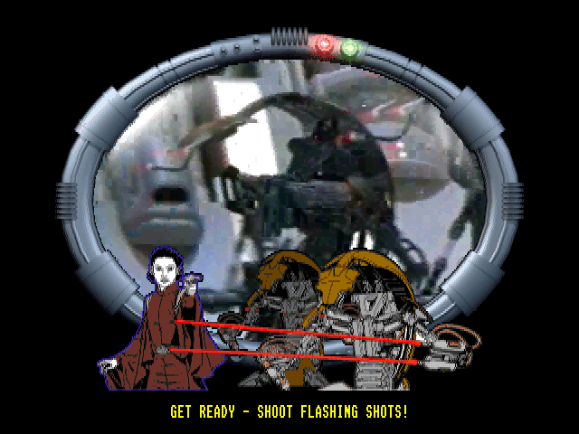 |  |
| **02 — Federation Fighters** (`scene:2`) | 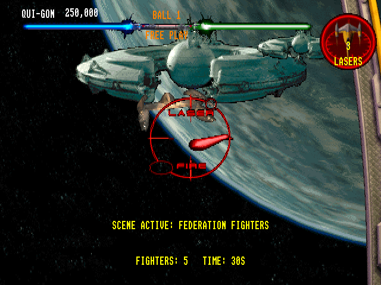 | 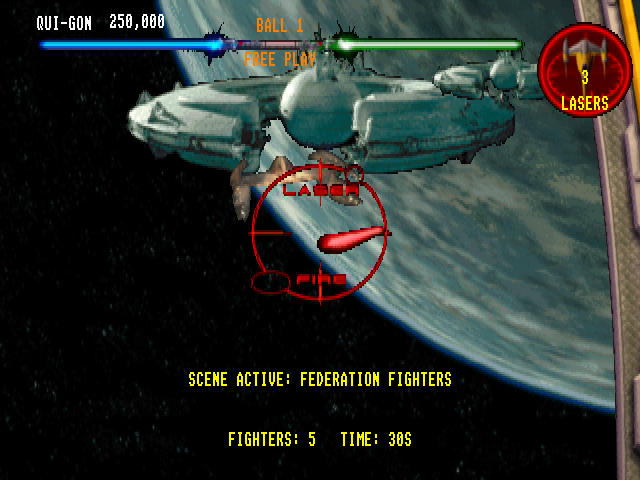 |
| **03 — Gungan Energy Battle** (`scene:3`) |  |  |
| **04 — Theed Hangar Escape** (`scene:4`) |  | 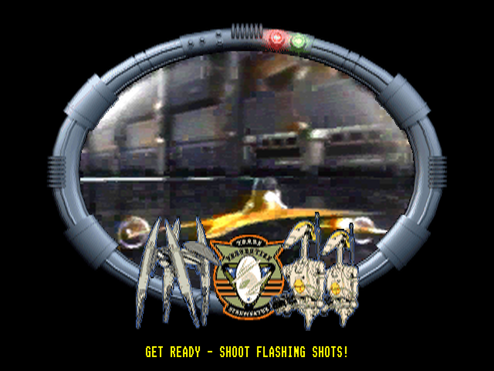 |
| **05 — AAT Hover Tank** (`scene:5`) | 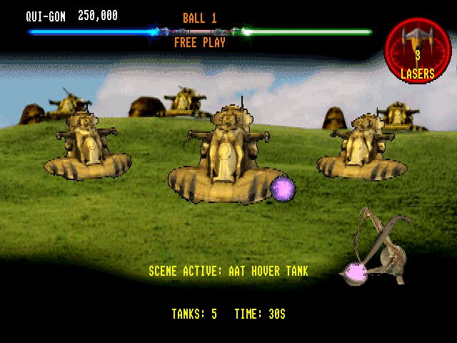 |  |
| **06 — Boonta Eve Podrace** (`scene:6`) |  |  |
| **07 — Sith Probe Droids** (`scene:7`) |  | 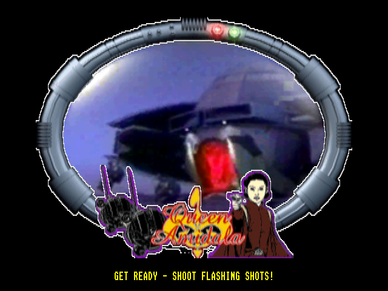 |
| **08 — Queen Amidala Wardrobe** (`scene:8`) |  | 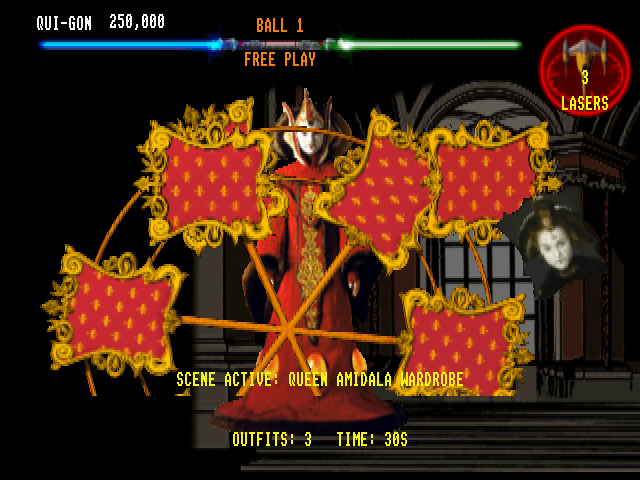 |
| **09 — Jar Jar Juggle** (`scene:9`) |  |  |
| **10 — Watto's Chance Cube** (`scene:10`) |  |  |
| **11 — Mos Espa Cantina** (`scene:11`) | 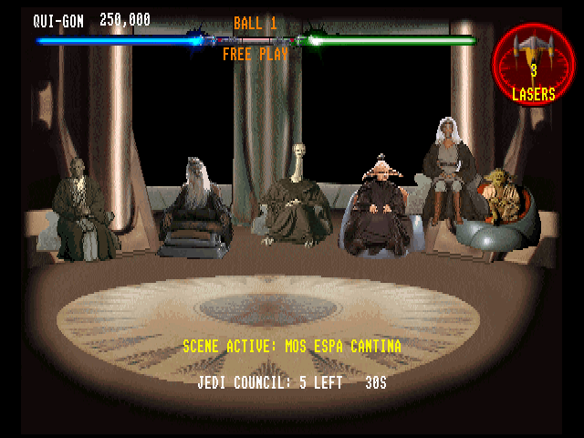 | 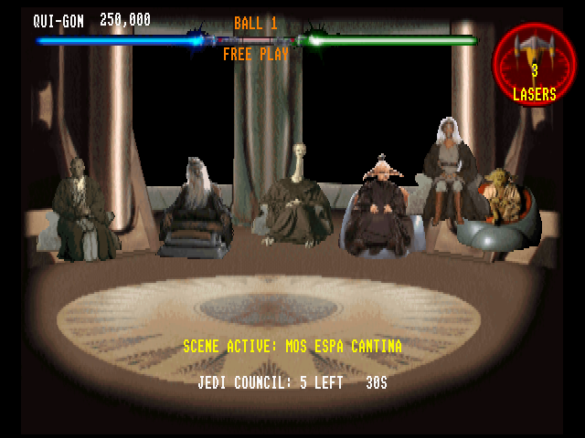 |
| **12 — R2-D2 Repair** (`scene:12`) |  | 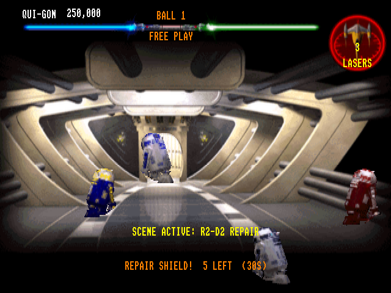 |
| **13 — Mystery (`?`)** (`scene:13`) |  |  |

---

## 5. Output Scales (`1×`, `2×`, `4×`, `8×`) & Antialiasing (`--aa`)

Captured on *Boonta Eve Podrace* (`scene:6`, frame `500`). Note: `--display-filter <nearest|bilinear|crt>` also applies real-time bilinear / CRT scanline filtering when presenting into a `--window` or `--fullscreen` viewport.

| Mode / Flags | Output Resolution | Screenshot |
|---|---|---|
| Native (`1×`) | `640×480` |  |
| `--hd --hd-scale 2` (1-bit alpha, no `--aa`) | `1280×960` |  |
| `--hd --hd-scale 2 --aa` (soft-alpha edge blending) | `1280×960` |  |
| `--hd --hd-scale 4 --aa` | `2560×1920` | 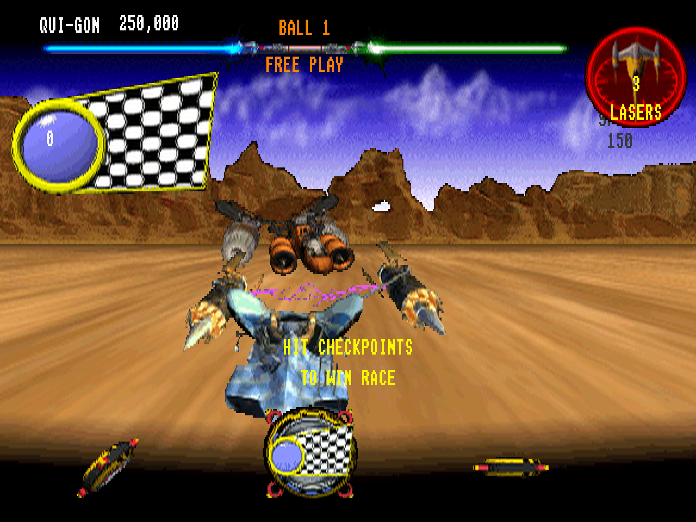 |
| `--hd --hd-scale 8 --aa` | `5120×3840` |  |

---

## 6. Offline Neural Upscaling Guide (`scripts/upscale_pytorch.py`)

`scripts/upscale_pytorch.py` upscales extracted `gfx/` PNG sequences using PyTorch and [`spandrel`](https://github.com/chaiNNer-org/spandrel) (supporting `.pth` and `.safetensors` checkpoints such as Real-ESRGAN, MoSR, PLKSR, SwinIR, DAT, ATD) or a built-in PyTorch `bicubic` antialias fallback when `--model` is omitted.

### Prerequisites

```bash
pip install torch numpy pillow spandrel safetensors
```

### CLI Options

| Flag | Default | Description |
|---|---|---|
| `--assets-dir <PATH>` | `work/swe1_assets` | Root assets folder containing `gfx/gfx_manifest.json`. |
| `--output-dir <PATH>` | `<assets-dir>/gfx_hd_<model>` | Destination folder. When omitted, suffixed with the model filename stem (or `bicubic` if no `--model`). |
| `--scale <2\|3\|4\|8>` | `2` | Target output scale factor. If the model's native scale differs (e.g. a `4×` model with `--scale 2`), the output is cleanly resampled with bicubic antialias. |
| `--model <PATH>` | `None` | Path to a `.pth` or `.safetensors` super-resolution checkpoint. |
| `--anim <SUBSTR>` | `None` | Case-insensitive substring filter on `symbol_name` (e.g. `--anim podrace` or `--anim kahuna`) for fast previews. |
| `--fp16` | `False` | Enables float16 inference on CUDA (`model.half()` when `supports_half` is true, otherwise `torch.amp.autocast`). |
| `--tile <PX>` | `256` | Tile size (with 16 px overlap) for large frames (`640×240`) to prevent CUDA OOM on 8 GiB GPUs. Set `0` to disable tiling. |
| `--blend <0..1>` | `1.0` | Mixes AI output with bicubic antialias (`blend * AI + (1 - blend) * bicubic`, e.g. `0.65`) to curb GAN texture shimmer. |
| `--soft-alpha` | `False` | Preserves smooth bicubic alpha edges instead of a hard 1-bit `0.5` threshold (pair with `pin2k-desktop --aa`). |
| `--temporal-stabilize` | `False` | Enables motion-aware temporal EMA guided by `1×` source frame deltas to eliminate static-background flicker without ghosting. |
| `--temporal-strength <0..1>` | `0.65` | Temporal blend strength applied to static regions when `--temporal-stabilize` is active. |
| `--temporal-threshold <0..1>` | `0.03` | `1×` source delta threshold below which a region is considered static. |
| `--resume` | `False` | Skips frames that already exist in `--output-dir` so interrupted runs can resume cleanly. |

### Pipeline Details

1. **RGB Edge-Padding (`edge_pad_rgb`)**: Dilates opaque RGB colors 2 passes into adjacent `alpha == 0` pixels so neural convolutions never sample black/magenta (`0x7C1F`) background values across sprite borders.
2. **Alignment & Tiling (`infer_tiled`)**: Splits frames larger than `--tile` into overlapping tiles (`tile_pad=16`), pads each tile to a multiple of 8 with replicate border padding, runs inference, and crops back to exact target dimensions.
3. **Temporal Consistency & Alpha**: Optional `--blend`, `--temporal-stabilize` (motion-aware EMA using `1×` source deltas), and `--soft-alpha` prevent frame-to-frame flickering and 1-bit silhouette popping.
4. **Live Progress Bar**: Displays completion percentage, processed/total frame count, throughput (`img/s`), and ETA.

### Usage Examples

```powershell
# 1. Quick preview with temporal stabilization + soft alpha + AI/bicubic blend
python scripts/upscale_pytorch.py --scale 4 --model work/models/4xNomos2_realplksr_dysample.safetensors --anim podrace --fp16 --temporal-stabilize --blend 0.75 --soft-alpha

# 2. Full 4x neural run writing directly to gfx_hd/ for pin2k-desktop --hd
python scripts/upscale_pytorch.py --scale 4 --model work/models/4xNomos2_otf_esrgan.safetensors --output-dir work/swe1_assets/gfx_hd --fp16 --temporal-stabilize --resume

# 3. Launch pin2k-desktop using the generated gfx_hd/ pack at 4x (2560x1920)
.\target\release\pin2k-desktop.exe --assets-dir .\work\swe1_assets --hd --hd-scale 4 --aa --window
```

> [!NOTE]
> `pin2k-desktop --hd` reads `<assets-dir>/gfx_hd/gfx_manifest.json` by default, or you can override it directly with `--hd-dir <PATH>` (which also implies `--hd`), e.g. `--hd-dir work/swe1_assets/gfx_hd_2x-DeGif_4x`.

---

## 7. Multi-Frame Video Super-Resolution (`scripts/upscale_vsr.py`)

For maximum temporal consistency across animation sequences and pre-rendered `comp 30` movies, `scripts/upscale_vsr.py` processes each animation as a temporal sliding window `[t - r .. t + r]` in two modes:

1. **Optical-Flow Temporal Fusion (default)**: Upscales each frame with an optional `spandrel` `--model` (or bicubic fallback), computes dense Farneback optical flow (`opencv-python`) between consecutive `1×` frames, warps neighboring `4×` frames onto the center frame, and performs occlusion-aware photometric fusion (`--temporal-weight`, `--sigma`).
2. **TorchScript Multi-Frame VSR (`--vsr-model`)**: Runs a multi-frame VSR network (e.g. RealBasicVSR / BasicVSR++ / RealVSR exported as TorchScript) over `btchw`, `bcthw`, or channel-concatenated `concat` windows (`--layout`).
3. **Automatic Single-Frame Dispatch (`--single-model`)**: Animations containing only **1 frame** (static backdrops, logos, overlays) automatically bypass optical-flow/VSR and use `--single-model` (or `--model` when omitted) directly.

```powershell
# Optical-flow VSR with a spandrel model on podrace
python scripts/upscale_vsr.py --scale 4 --model work/models/4xNomos2_realplksr_dysample.safetensors --anim podrace --fp16 --soft-alpha

# Dedicated single-frame model (MoSR) + multi-frame VSR (PLKSR + optical flow)
python scripts/upscale_vsr.py --scale 4 --single-model work/models/4xNomos2_hq_mosr.safetensors --model work/models/4xNomos2_realplksr_dysample.safetensors --fp16 --soft-alpha --resume

# Multi-frame TorchScript VSR model with single-frame fallback
python scripts/upscale_vsr.py --scale 4 --single-model work/models/4xNomos2_hq_mosr.safetensors --vsr-model work/models/RealBasicVSR.pt --layout btchw --fp16 --soft-alpha
```
