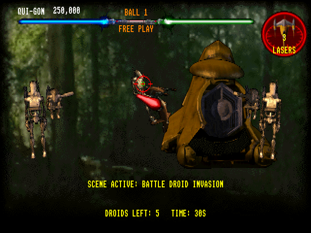
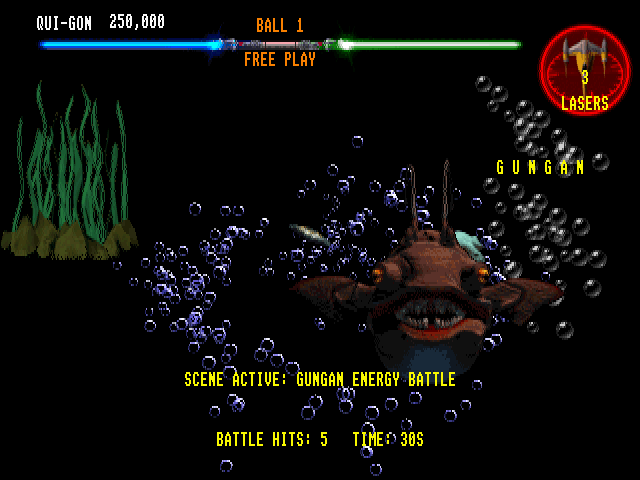
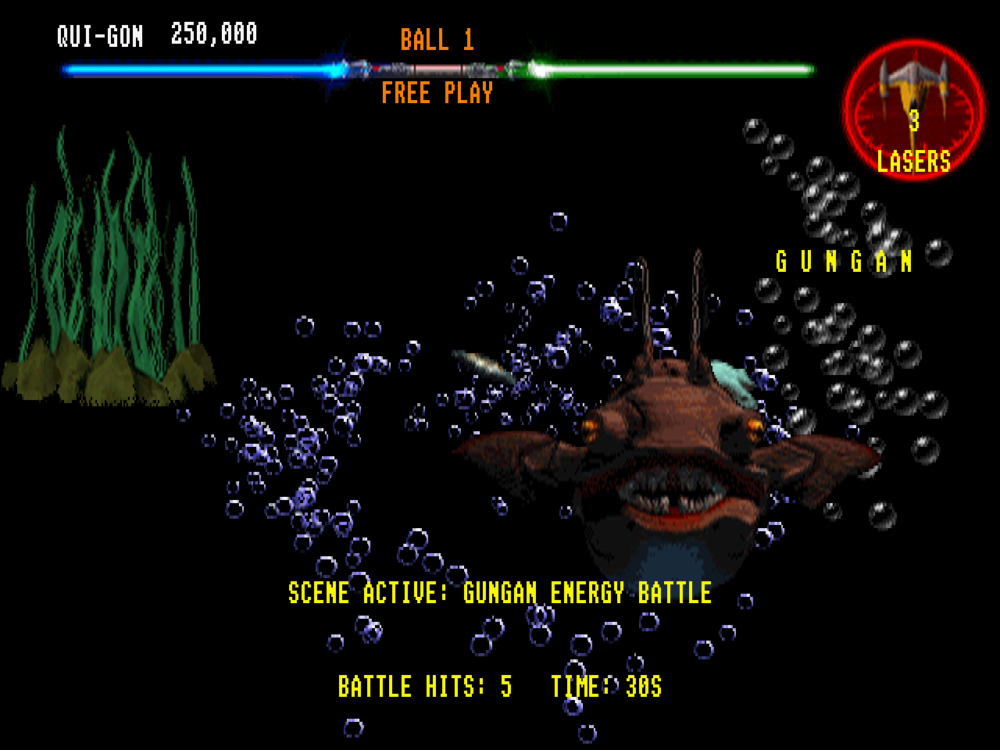
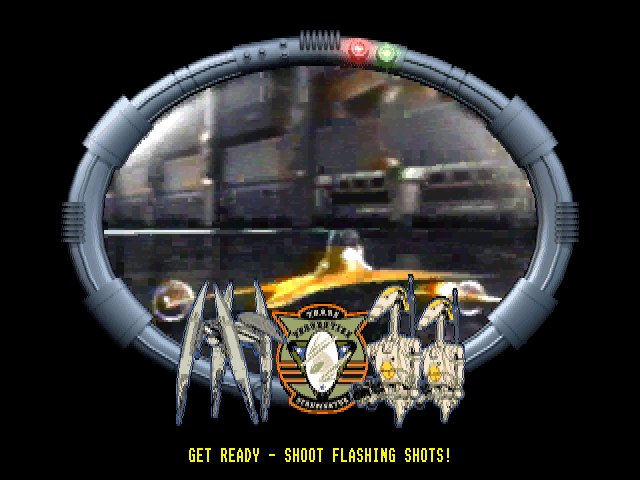
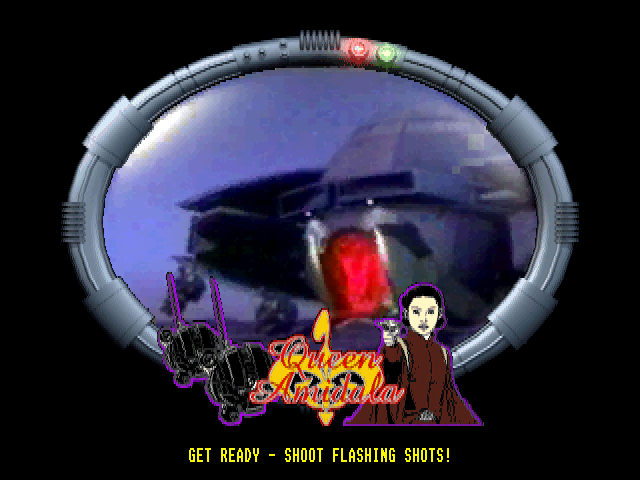
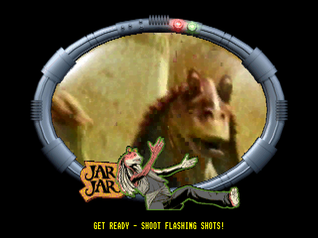
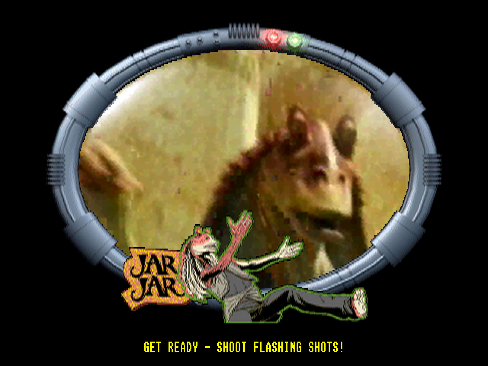
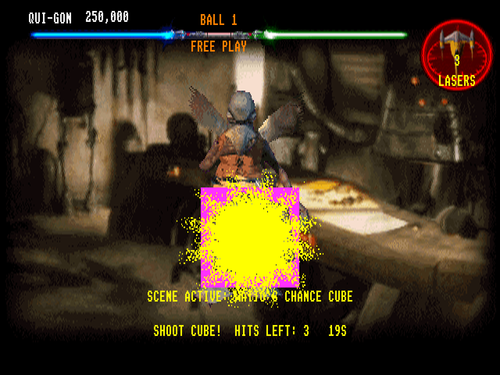
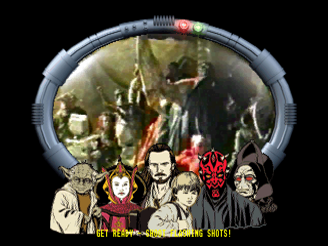
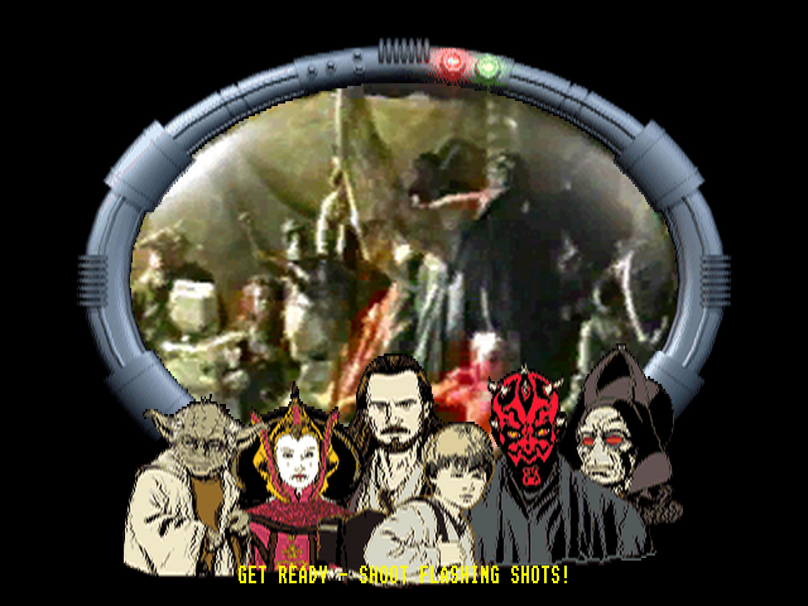

# Technical Study: HD Upscaling & Rendering in `pin2k`

This document analyzes the technical options, constraints (RGB555 transparency, RAM budget, FPS timing), and implementation plan for upgrading `pin2k` from native **`640×240` → `640×480`** to **HD (`1280×960`, `1920×1080`, or `4K`)**.

---

## 1. Current Pipeline Constraints

- **Native ROM resolution & Z-sorted compositor**: PRISM / MediaGX renders **`640×240` RGB555 (15-bit)**, vertically scan-doubled to **`640×480`** for the cabinet Pepper's Ghost reflection. `SoftwareCompositor` implements full Z-sorting (`BaseViewManager`) with `flip_x`, RGB555 monochrome tint, and all **19 ROM bitmap fonts** with drop shadows.
- **Movies vs Sprites**:
  - Scene intro movies (codec `30`, `220×160` @ 15 fps) are horizontally doubled (`scale_x = 2` → `440×160`) inside `anim_jedi_scene_intro_frame` (`z = 202`).
  - Fullscreen `320×240` cinematics (`anim_darth_maul_game_over`, `anim_match_movie`, `anim_extra_ball_show`, `anim_multiball_start_movie`) are stretched **`scale_x = 2`** to `640×240`.
  - Sprites and backgrounds (codecs `0, 1, 20..23, 42..45`) use transparent key **`0x7C1F` (magenta)** mapped to RGBA alpha (`0` or `255`).
- **Memory (`LoadedAnim`)**: `compositor.rs` lazily decodes and caches frames in RAM (`decoded_frames: Vec<RgbaImage>`).

---

## 2. Two Complementary Upscaling Approaches

### Approach A — Offline Asset Upscaling (`pin2k-rom-tool upscale-assets` → `gfx_hd/`)

Pre-computes HD versions (`2×`–`4×`) of extracted `.png` assets:

| Asset Type | Recommended Algorithm | Rationale |
|---|---|---|
| **2D Sprites / UI / Icons** (`comp 0, 1, 20..23`) | **Edge-padded Lanczos3 / xBRZ** | Smooths pixel stair-stepping while keeping crisp silhouettes. |
| **Pre-rendered 3D Movies** (`comp 30` @ 15 fps, `220×160`) | **Lanczos3 / CatmullRom** or AI (**Real-ESRGAN**) | Reconstructs 3D detail and reduces 15-bit RGB555 banding. |
| **Bitmap Fonts (`fonts/`)** | **2×/3× upscaling** or TTF/OTF override | Maintains sharp readability at high resolution. |

#### Critical Pitfall: Alpha Fringes (`0x7C1F` dark/magenta halos)
Naive multi-tap resizing on RGBA PNGs blends opaque silhouette colors with black/magenta transparent pixels (`alpha = 0`), creating dark or colored fringes.

**Implemented solution (`crates/pin2k-rom-tool/src/upscaler.rs`)**:
1. **Transparent RGB edge-padding (`edge_pad_transparent_rgb`)**: dilates RGB values from opaque 8-neighbors into adjacent `alpha == 0` pixels for 2 passes before resizing.
2. **High-quality kernel resize**: `Lanczos3`, `CatmullRom`, or `Nearest` (`2×`–`4×`).
3. **Crisp silhouette alpha thresholding**: optional binary alpha restoration (`--soft-alpha` to preserve smooth alpha) so 1-bit Pinball 2000 silhouettes remain halo-free.

#### Memory Budget (RAM)
- At `640×240`, 1 RGBA frame = `614 KiB`.
- At `3×` (`1920×720`), 1 RGBA frame = **`5.5 MiB`** (`9×` larger). Adding a **bounded LRU frame cache** (e.g., max 128 MiB) in `LoadedAnim` is recommended before enabling full-set `3×`/`4×` packs.

---

### Approach B — Real-Time Upscaling in `pin2k-desktop`

| Variant | Location | Pros | Limits |
|---|---|---|---|
| **WebGL2 Shaders (`web_ui.html`)** | Browser client | **Zero server CPU cost**, lightweight `/frame.png` stream, instant **xBRZ / Bicubic / CRT Scanlines** at 60 Hz. | Web mode (`--web-port`) only. |
| **Native Window (`window.rs`)** | `winit` + `softbuffer` | Zero C deps, `4:3` letterboxing, `--hd` (`gfx_hd/`) supersampling. | Software scaling on CPU. |
| **Native GPU Post-Processing (`wgpu`)** | Rust GPU (Win/Linux) | Native `1080p`/`4K` at 60 fps with xBRZ + CRT shaders. | Adds GPU pipeline dependency. |

---

## 3. Implementation Status

1. **[Done] Built-in Offline Upscaler (`pin2k-rom-tool upscale-assets`)**: pure-Rust edge-padded `Lanczos3`/`CatmullRom`/`Nearest` generator (`2×`–`8×`) writing `gfx_hd/gfx_manifest.json` while preserving edge-padded RGB on transparent pixels.
2. **[Done] Offline PyTorch / Real-ESRGAN Upscaler (`scripts/upscale_pytorch.py`)**: supports `2×`/`4×`/`8×` neural super-resolution via `spandrel` (`.pth` weights) or PyTorch `bicubic` antialias with separate 1-bit alpha upscaling.
3. **[Done] Native HD Output, Global 256 MiB LRU Cache & Display Filters (`pin2k-desktop`)**:
   - `--hd` + `--hd-scale <1|2|4|8>` renders directly at `1280×960` (`2×`), `2560×1920` (`4×`), or `5120×3840` (`8×`) with a global `256 MiB` byte-bounded LRU frame cache (`SoftwareCompositor`).
   - `--display-filter <nearest|bilinear|crt>` adds real-time bilinear antialiasing and optional Pepper's Ghost CRT scanlines in `window.rs`.
   - `--aa` enables soft alpha-blending on sprite edges in `raster.rs`.
4. **[Next] WebGL2 Client Shaders & `wgpu` GPU Backend**: add selectable `Native / Bicubic / xBRZ / CRT` shaders in `web_ui.html` and a native `wgpu` backend for full-speed `8×` (`5120×3840`) at 60 Hz.

---

## 4. Scene-by-Scene Visual Comparison (`1×` Native vs `--hd` `2×` Lanczos3)

All 14 SWE1 scenes captured from `pin2k-desktop` (left: native `1×` `640×480` from `gfx/`, right: `--hd --aa` `2×` `1280×960` from `gfx_hd/` generated by `pin2k-rom-tool upscale-assets`):

| Scene | Native (`1×`) | HD Upscaled (`--hd` `2×` Lanczos3) |
|---|---|---|
| **00 — Battle Droid Invasion** (`scene:0`) |  |  |
| **01 — Destroyer Droids** (`scene:1`) |  |  |
| **02 — Federation Fighters** (`scene:2`) |  |  |
| **03 — Gungan Energy Battle** (`scene:3`) |  |  |
| **04 — Theed Hangar Escape** (`scene:4`) |  |  |
| **05 — AAT Hover Tank** (`scene:5`) |  |  |
| **06 — Boonta Eve Podrace** (`scene:6`) |  |  |
| **07 — Sith Probe Droids** (`scene:7`) |  |  |
| **08 — Queen Amidala Wardrobe** (`scene:8`) |  |  |
| **09 — Jar Jar Juggle** (`scene:9`) |  |  |
| **10 — Watto's Chance Cube** (`scene:10`) |  |  |
| **11 — Mos Espa Cantina** (`scene:11`) |  |  |
| **12 — R2-D2 Repair** (`scene:12`) |  |  |
| **13 — Mystery (`?`)** (`scene:13`) |  |  |
